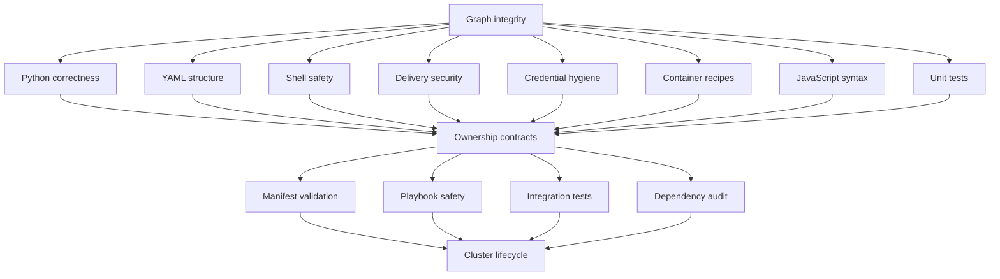

# Home Lab Quality Graph

## PR182: CI enablement and reviewed refactoring

The operator changed the integration scope: PR182 sets up CI and integrates reviewed refactoring; eliminating every pre-existing source finding is follow-up work based on main. Red source checks are visible and do not become accepted baselines or approvals. An owner may separately decide to merge red CI; this is not an instruction to bypass protection, weaken tests or claim strict green. See [integration checklist](ci-enablement.md), [enforcement policy](strict-policy.md) and [historical evidence](strict-status.md).

`qg.yaml` is authoritative. Generate workflows and `.quality-graph/manifest.json` only through the pinned owning compiler (`uv run qg generate`); never hand-edit generated YAML. `qg validate` verifies freshness, not source cleanliness.

## Active CI scope

CI runs `graph`, followed by `secrets`, `javascript`, `ownership`, `docker`, `workflow`
and `rustfs-return-types`. The latter blocks missing public return annotations (Ruff
`ANN201`) in `services/rustfs_gateway/`; the full Python check remains available locally.
Ownership runs six offline checks plus their regression suites; the Ansible
entrypoint scan covers both `.yml` and `.yaml`.
The other nine checks remain runnable by name; `make check` and its alias
`make check-all` attempt both active and local-only checks. Restore a
check to `qg.yaml` and remove its local-only entry once it is verified green.

## Historical 15-node DAG (before PR #454)



Independent fast nodes collect failures together. Ownership is a real source-contract gate. Integration, manifests, Ansible and dependencies run after it; the disposable cluster runs after the middle stage. Downstream skipped jobs are **not passed**. There is no always-success path, approval escape, cap bypass or artificial shard. Do not infer hosted downstream coverage from separately running local checks.

## Enforcement and owning files

| Surface | Actual enforced checks | Owner |
| --- | --- | --- |
| Python | Ruff ALL, mandatory formatter, strict mypy plus additional error codes, owned-file/syntax coverage | `quality/ruff.toml`, `quality/mypy.ini`, `scripts/quality/lint.py` |
| YAML | strict yamllint, duplicate keys, tags/typing/quotes, framing, comments, length and whitespace | `quality/yamllint.yaml` |
| Shell | ShellCheck `--enable=all`; supported workflow shell bodies also checked | `scripts/quality/lint.py` |
| Delivery | actionlint; zizmor auditor, including generated workflows | `scripts/quality/lint.py` |
| Credentials | Gitleaks; immutable exact reviewed false positives; context drift remains blocking | `quality/secret-false-positives.json`, `quality/strict-policy.json` |
| Containers | Hadolint at style threshold; inline/global ignore pragmas disabled; owned Dockerfile and Containerfile names (plain, prefix or suffix, case-insensitive) | `quality/hadolint.yaml`, `scripts/quality/lint.py` |
| JavaScript | Node syntax checks; actual Node/PromQL/parser regression fixtures in reviewed suites | `scripts/quality/lint.py`, `quality/test-suites.json` |
| Ansible | offline strict ansible-lint, parser floor plus enumerated non-conflicting rules | `quality/ansible-lint.yaml` |
| Kubernetes | Helm rendering, local checksum-locked schema validation, default plus additional kube-linter checks and source contracts | `scripts/quality/charts.py`, `quality/kube-linter.yaml`, `quality/schemas.lock.json` |
| Dependencies | Python requirement/hash validation and pip-audit; exact npm lock/manifest integrity and TLS OSV auditing; unsupported locks block | `scripts/quality/lint.py` |
| Architecture | mesh/inventory, native issuer transport, deployment/source/vendor ownership and operational entrypoint contracts | `deploy/contracts/`, `scripts/check_*`, `scripts/quality/boundaries.py` |
| Test coverage | explicit disjoint test inventory, offline fast/medium suites, real disposable Kind suite | `quality/test-suites.json`, `scripts/quality/tests.py`, `tests/kubernetes/` |

`quality/rules.json` and `quality/debt/` are historical catalogs/receipts, not current enforcement or acceptance. Tool/collection/schema locks live under `quality/`. Root project defaults are not interchangeable with the owning quality formatter config.

## Exceptions: small, explicit, not a debt waiver

- Ruff ignores only four documented conflicting rule choices: D203/D213/ISC001/COM812. Test directories (`test/` and `tests/`) do not require method docstrings (D102); `tests/` also allows S101 because pytest rewrites assertions. Other test/style/security findings are not ignored.
- YAML key-ordering conflicts with semantic Ansible task ordering. Compatible implicit-null and quoted-string checks are enabled. Cross-schema truthy key handling preserves GitHub `on`.
- Installed Ansible/Kubernetes optional rules are either enabled or have precise applicability/architecture reasons in `strict-policy.md` and `strict-policy.json`; replica/scheduler/single-writer identities are not rewritten to satisfy arbitrary optional rules.
- Hadolint's single DL3064 false-positive exception binds one exact public ENV line. Reviewed non-secret contexts are immutable and exact, not secret waivers. Drift fails.
- Vendor boundaries are centrally declared. Generated workflows are still scanned and have no finding waiver. Inline suppressions remain forbidden and checked.

This is strict configuration for the adopted tools, **not a claim that every conceivable checker is installed**. ESLint/Prettier execution, separate Bandit/Vulture runs and broader mutation coverage are not enabled; do not count them as passes. Those are explicit coverage/tool-lock follow-ups, not hidden successful nodes.

## Test inventory and safety

pytest is the single runner, including unittest classes. All test modules under `tests/` and `experiments/` must be explicitly scheduled or named with a reason in `notScheduled`; unknown/stale/overlapping entries fail Graph integrity. No global pytest discovery of operational or autonomous experiments is authorized. The synchronization inventory is 162 scheduled of 312 modules; the remaining150 are explicit coverage gaps, not passed tests. Re-run contracts for current counts.

Newly reviewed pure helper/publisher-negative/dashboard tests join fast; source-only Helm upgrade assertions join medium and do not execute Jobs or backups. Two newly synchronized owner tests import provisioning/validation entrypoints and remain explicitly unexecuted pending bounded isolation review. Five experimental autonomy test modules remain deferred. No previously scheduled module was removed.

Linux fast/medium use loopback-only network namespaces and stripped cloud/SSH/operator-kubeconfig variables. This prevents accidents, not hostile-code execution. Kind uses locked binaries, a UUID cluster, a private loopback kubeconfig, no production data/credentials and exact cleanup; never docker prune. It exercises actual scheduling, Service HTTP, scale, invalid Deployment rejection, RBAC and local PV Retain. It is not K3s/SSO/backup/runtime acceptance. Historical hosted Kind success is not current-head hosted green.

## Failure and report semantics

Findings, incomplete audit coverage, adapter failures and absent/oversized native artifacts all remain failures. In particular, a failed envelope with an empty finding list is **not clean**. Native Python reports previously exceeded the unchanged 10 MiB admission limit. The generated publisher is audited like every other workflow; a clean Delivery security result does not establish that the scheduled publisher reconciled the PR. Do not truncate/shard reports or refresh approvals to hide them.

Private complete audit evidence is outside Git at `~/Library/Application Support/homelab/quality-strict/` (directories0700/files0600). `strict_report.py` returns1 when findings remain; configurationReady/snapshotStable must also be checked. Old receipts describing exit0-with-findings are historical behavior, not the current contract. A current audit binds an exact clean source head; dirty/in-progress merge evidence is not exact-head acceptance.

## Reproduce

```sh
uv sync --locked
uv run qg validate
uv run python scripts/quality/contracts.py
uv run python scripts/quality/strict_guard.py
uv run python scripts/quality/lint.py python
uv run python scripts/quality/lint.py yaml
uv run python scripts/quality/tests.py fast
uv run python scripts/quality/tests.py medium
```

Actual Linux jobs add `--isolate-network` to fast/medium. Install only required pinned binaries via `scripts/quality/install_tools.py` and parsing collections via `scripts/quality/install_collections.py`; do not substitute system versions silently. Use `.venv/bin:.quality-tools/bin` in scoped PATH and `KUBECONFIG=/dev/null` for offline checks. Cluster testing requires an explicitly reviewed disposable Docker/Kind environment; it is not implicitly run by these offline commands.

Publication uses the private fail-closed draft publisher: fresh main/remote ancestry, stable clean head, complete audit metadata, verified open draft and one non-force push. Any refusal means no separate push. PR metadata must identify actual published head and real results. No main merge, admin bypass, production execution, backup/identity/model/worker/provider operation is performed by CI/refactoring preparation.
