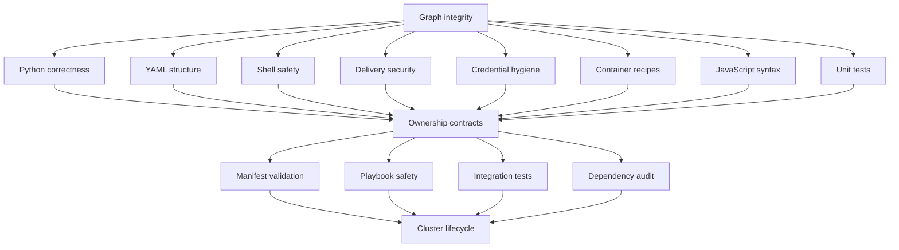

# Home Lab Quality Graph

The current design is a **semantic, cost-layered DAG**, not a job per application
or a job per hash bucket. `qg.yaml` is authoritative; generated workflows and
`.quality-graph/manifest.json` must be updated with `uv run qg generate`.

## Execution order



- Graph/schema/tool/test inventory integrity is the initial prerequisite.
- Independent fast checks run together, including unit tests. A formatter failure
  does not prevent other checks at the same level from reporting their findings.
- Ownership contracts are the real readiness gate after every fast check passes,
  not an artificial no-op barrier. The other middle-stage checks depend on this
  source/ownership validation and run in parallel. This keeps the graph readable
  without an all-to-all tangle of duplicated prerequisite edges.
- A real disposable Kubernetes cluster starts only after the entire middle stage
  passes. No `always()`, fake-success fallback or ignore approval bypasses this.
- All node titles have distinct leading names. Helm covers all58local chart roots
  in **one** manifest-validation node, not four artificial shards.

The graph's execution order/unique titles are regression-tested. Tool profiles
install only the relevant binaries, rather than downloading every linter in each
job. Checkout/Helm actions use reviewed Node24-compatible commit pins.

## Three test levels, one runner

**pytest runs all tests**, including existing `unittest.TestCase` classes. There
is no second unittest execution pass and no pointless assertion-syntax migration.

1. **Unit tests**: pure algorithms, fail-closed interfaces and source contracts.
   Small local substitutes remain appropriate for checking refusal/no-side-effect
   behavior. They are not called runtime integration acceptance.
2. **Integration tests**: actual Helm/Ansible/parser processes and cross-file
   contracts. Modules using external processes are grouped here; not one CI node
   per service. Actual ansible-lint negative cases prove unsafe pipelines and
   unresolved modules are rejected without executing the plays.
3. **Cluster lifecycle**: actual Kind Kubernetes1.36.4API server, scheduler,
   kubelet and RBAC. Tests exercise a repository Cats chart release using an
   explicit public nginx test workload, real Service HTTP and replica changes;
   API rejection of an invalid rendered Deployment; source-owned application
   reader permissions; local PV binding and Retain after PVC deletion.

Kind was selected after reviewing its official guide and Chainsaw's declarative
assertion/lifecycle/reporting model. pytest fixtures fit this Python repository
without introducing a second test DSL. Kind is upstream Kubernetes, **not** a
claim that K3s/Traefik/WireGuard/NFS or private application business logic ran.

Fast/medium Linux test processes have loopback-only network namespaces, no SSH
agent/cloud credentials and no operator kubeconfig. That is accidental-network
protection, not a hostile-code sandbox. The cluster suite instead creates a
UUID-named cluster with an explicit private kubeconfig, validates its loopback
API/context and always deletes only that exact cluster. It never merges/writes
`~/.kube/config`, mounts production data or uses production credentials.

The inventory now counts nested test directories honestly:116of275modules are
scheduled;159remain explicitly unreviewed/deferred, **not passed**. Adding a test
without classifying it fails integrity checks. The old241count covered root-level
modules only. Neither historical migration fixtures nor current source assertions
are proof of production runtime, backup coverage or disaster recovery.

## Ansible policy, not an accidental API migration

The original broad `safety` preset inherited style rules for task names, role
variable prefixes and line lengths. Its865finding audit is **not claimed fixed**.
Renaming stable public role variables would be an infrastructure API migration,
not an honest way to repair this CI implementation. YAML hygiene is separately
checked across all owned source; CI Python formatting remains strict.

The required gate now positively enumerates mandatory parser/syntax checks,
schema and12correctness/security rules in `quality/ansible-lint.yaml` and
`quality/rules.json`. It scans all358owned Ansible YAML files, with **no** mock
modules, skipped files, warn-only findings or technical-debt baseline. Real
parse/schema/module errors were repaired, collection dependencies are checksum
locked,19shell pipelines now propagate upstream failures, and the kernel's
intentional install/update flow uses a distinct update-only step. Nothing ran
against a managed host. Stylistic modernization is a separate explicit review,
not a hidden successful result from the broad preset.

## Reports and retained debt

- Native lint reports and pytest JUnit are admitted/published by Quality Graph.
  Setup/parser/tool errors are failures, never accepted quality findings.
- Existing Python/YAML/shell/resource debt is still visible as known-not-fixed
  metrics. Combining chart inventories was a mechanical union of existing IDs,
  **not** a new baseline capture. No regression test was xfailed/removed to pass.
- Gitleaks non-secret contexts remain separately reviewed, never secret waivers.
- Hadolint DL3064 misidentifies the public `TOKENIZERS_PARALLELISM=false` flag as
  a credential. The adapter permits only that exact existing option line in one
  Dockerfile; an adversarial test proves changed values lose the exception.
  Seven other Docker findings were repaired, not ignored.
- All declared nodes disallow finding/file/node approval escapes. `/qg help` and
  `/qg status` use the native provider; no custom command bot is introduced.

## Reproduce

```sh
uv sync --locked
uv run qg validate
uv run python scripts/quality/contracts.py
uv run python scripts/quality/lint.py python
uv run python scripts/quality/lint.py yaml
uv run python scripts/quality/tests.py fast
uv run python scripts/quality/tests.py medium
```

Actual Linux CI adds `--isolate-network` to fast/medium. External binaries come
from `quality/tools.lock.json`; Ansible parsing dependencies come from
`quality/collections.lock.json`. Install only the required tools:

```sh
uv run python scripts/quality/install_tools.py --tools kubeconform kube-linter
uv run python scripts/quality/install_collections.py
export PATH="$PWD/.quality-tools/bin:$PATH"
uv run python scripts/quality/charts.py
# Explicitly creates/deletes a disposable cluster; requires supported Docker:
uv run python scripts/quality/install_tools.py --tools kind kubectl
uv run python scripts/quality/tests.py cluster
```

A rootless local Podman provider refused Kind because its VM lacks systemd
Delegate configuration. No host/VM settings were changed and no mock fallback was
used. Actual hosted Linux acceptance [43954132178](https://github.com/alchemmist/homelab/actions/runs/43954132178)
passed all4cluster tests with0skips. That targeted diagnostic run is not a claim
that the full graph passed; see the latest full PR run separately.

[Research and primary sources](research-20261116.md) and
[dated initial failures/repair evidence](initial-findings-20261116.md).
No production, backup implementation, GPU/VPN maintenance or public Wiki writes
are authorized by this quality package. Branch protection remains unchanged.
